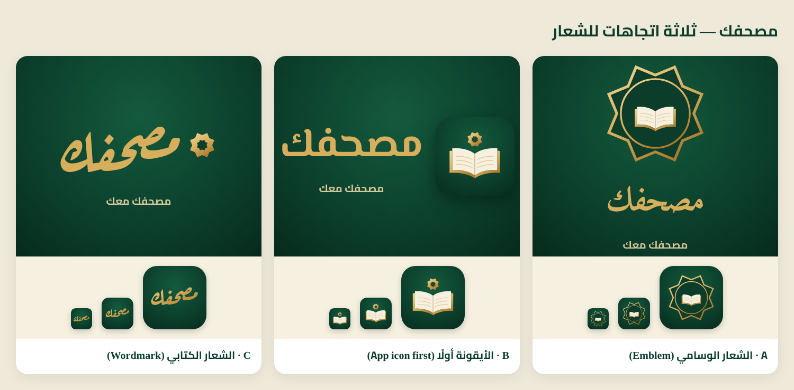
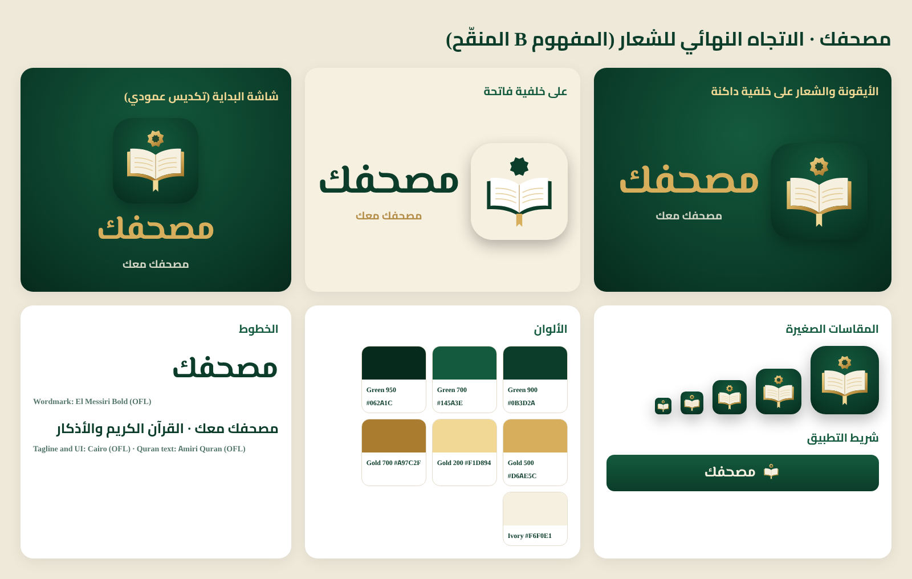

# مصحفك: brand and logo

- Name: **مصحفك**
- Tagline: **مصحفك معك**
- Store title: **مصحفك – القرآن الكريم والأذكار** (30 characters, the App Store limit)

Name check (17 Oct 2026): App Store web searches for "مصحفك" and "Mushafak" found no app with
this name. "مصحف" is a common word used by many Quran apps, so expect neighbours in search
(e.g. مصحف قطر, مصحف مكة). This is not a trademark search; App Store Connect confirms the
name is free when it is saved on the app record.

## The three concepts

**A. Emblem.** A gold Rub el Hizb (eight-pointed star) frames a medallion holding an
open Mushaf, with the name in Amiri below.
- Symbolism: the Rub el Hizb marks every quarter-hizb in the printed Mushaf, so it
  belongs to Quran reading specifically, not to Islam in general.
- Strengths: it feels classic and dignified, and works well as a seal on print.
- Weaknesses: the thin outline and inner book get lost below 60 px. It is close to
  many existing "star medallion" Islamic logos.
- App icon suitability: medium.

**B. App icon first.** An open Mushaf with a gold cover and ivory pages, with a bookmark
ribbon at the spine, under a Rub el Hizb, on a deep-green tile. The name is set in El
Messiri beside or below it.
- Symbolism: the open Mushaf is "your Mushaf", the ribbon is "where you stopped",
  which matches the khatmah, wird and continue-reading at the heart of the app, and the
  Rub el Hizb is the Mushaf's own mark.
- Strengths: it reads clearly from 1024 px down to 29 px, and the silhouette is simple.
  It works on dark and light, and the symbol works alone in a header.
- Weaknesses: an open book is a familiar idea, so the star and ribbon do the work of
  making it ours.
- App icon suitability: high.

**C. Wordmark.** The name مصحفك set in Aref Ruqaa with a small Rub el Hizb as its signature.
- Symbolism: the name itself carries the brand.
- Strengths: it is the most distinctive and calligraphic of the three.
- Weaknesses: a word in an app icon is unreadable at small sizes, and Ruqaa is
  informal for a Quran app.
- App icon suitability: low. Best kept for marketing headlines.

## Chosen: B, refined

B is the best long-term choice. The icon is the brand's most-seen surface (home screen,
App Store, notifications), and B is the only concept that stays clear at every icon size.
It also tells the product story (your Mushaf, your place in it) without lettering in the
mark. The wordmark sits next to it, set in a real font.

Refinements: a larger star, a gold bookmark ribbon, the symbol optically centred in the
tile, and a light variant. No red was used, to stay in palette.

## Production brief

**Files** (`docs/brand/`)
- `app-icon.svg` and `app-icon-1024.png`: the master icon on deep green. It is opaque
  RGB, as the App Store requires.
- `app-icon-light.svg` and `app-icon-light-1024.png`: the light variant (green symbol on
  ivory), for light surfaces in marketing only.
- `symbol-gold.svg`: the symbol alone, for dark backgrounds.
- `symbol-green.svg`: the symbol alone, for light backgrounds.
- `splash-preview.jpg`: the native launch image.
- `source/`: the HTML/JS that generates everything.

**In the app**
- `components/brand/Brand.tsx` provides `BrandSymbol`, `BrandIcon`, `BrandLockup` and
  the `BRAND` strings.
- iOS app icons (all sizes) and the launch image are in `ios/App/App/Assets.xcassets`.
- `public/favicon.svg` and `public/apple-touch-icon.png` are for the web.

**Dark and light behaviour**
- On dark green, use the gold symbol and a gold wordmark, with the tagline in ivory at
  80% opacity.
- On ivory or white, use the icon tile (not the bare symbol), with the wordmark in
  Green 900 and the tagline in Gold 700. A bare green symbol is acceptable at 24 px or
  more.
- In dark mode, the wordmark switches to Gold 500.
- Clear space is at least 25% of the icon size on every side. Do not place the icon on
  photos or patterns.

**Palette**

| Token | Hex | Use |
|---|---|---|
| Green 950 | #062A1C | gradient edge, deep shadows |
| Green 900 | #0B3D2A | primary brand green, wordmark on light |
| Green 700 | #145A3E | gradient light, highlights |
| Gold 700 | #A97C2F | gold shadow, tagline on light |
| Gold 500 | #D6AE5C | primary gold, wordmark on dark |
| Gold 200 | #F1D894 | gold highlight, ribbon |
| Ivory | #F6F0E1 | pages, light surfaces |

**Typography**
- El Messiri Bold for the wordmark.
- Cairo for the tagline and UI.
- Amiri Quran for Quran text only.
- All three are SIL OFL 1.1 and bundled with the app.
- The wordmark is always typeset, never redrawn or distorted. Don't stretch it,
  outline it, or add letters or diacritics to it.

**Uses**
- App icon: the master icon.
- Splash: a stacked lockup (symbol, name, tagline) on the green radial background.
- Header or app bar: the symbol at 28–34 px with the wordmark at 26 px, only where a
  screen has no title (the tab screens keep their own titles).
- App Store screenshots: the stacked lockup on the first frame, and the gold symbol as a
  small corner mark on the others.
- Social and profile images: the icon tile on its own (the platform crops to a circle,
  so keep the tile centred with 10% padding).

**Never**
- Mosque clip-art, generated or pseudo-Arabic lettering, Quran text inside the mark,
  extra ornaments, drop shadows on the wordmark, or recolouring outside the palette.

**Limitation:** this is a code-built vector logo, made to the brief above. It is not
the work of a brand studio. A designer can redraw the symbol to this brief and drop in
same-named files.
